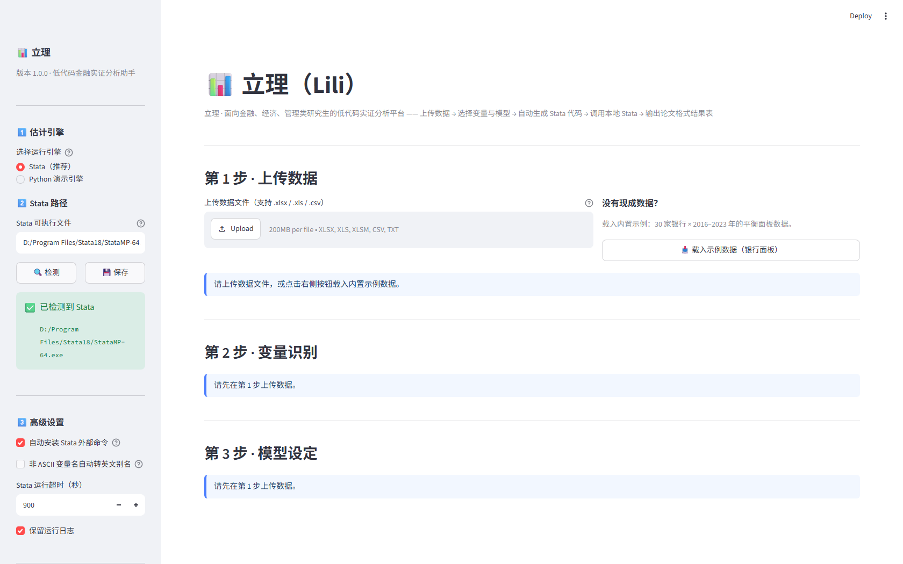

# 立理（Lili）

> **面向金融、经济、管理类研究生的低代码实证分析平台。**
> 不用写 Stata 代码：上传 Excel → 点选变量与模型 → 自动生成 do 文件 → 调用本地 Stata → 直接拿到**论文格式结果表**。

[](LICENSE)
[](https://github.com/ImZhangTong/-)
[](https://www.python.org/)
[](https://streamlit.io/)
[](https://www.stata.com/)
[](https://github.com/ImZhangTong/-/actions/workflows/ci.yml)
[](tests/)



---

## 目录

- [为什么做这个](#为什么做这个)
- [功能特性](#功能特性)
- [快速开始](#快速开始)
- [支持的计量模型](#支持的计量模型)
- [它生成的代码长什么样](#它生成的代码长什么样)
- [输出物](#输出物)
- [项目结构](#项目结构)
- [常见问题（FAQ）](#常见问题faq)
- [扩展开发：三步新增一个模型](#扩展开发三步新增一个模型)
- [测试](#测试)
- [路线图](#路线图)
- [贡献](#贡献)
- [许可与声明](#许可与声明)

---

## 为什么做这个

实证研究里最耗时的环节往往不是"想问题"，而是这几件重复劳动：

| 痛点 | 立理的做法 |
|---|---|
| 记不住 `reghdfe` 的一堆选项、`absorb()` 怎么写 | 界面点选模型，代码自动生成，**照抄即可** |
| `reghdfe` / `ftools` / `estout` 没装、装不上 | do 文件内置 `capture which` + `ssc install` 自动安装；装不上还能自动回退到内置 `xtreg` |
| 中文变量名、字符串 ID 导致 `r(109)` 之类报错 | 自动把 ID 生成数值编码 `_panel_id`；中英文变量名都实测可用 |
| 结果表要手工排版成三线表才能进论文 | 一键导出 **Word 三线表 / RTF / Excel**，含显著性星号、表注、模型设定附注 |
| 换一组控制变量就要重跑一遍、怕出错 | 界面改完一键重跑，样本与代码严格一致（可复现） |

**核心理念**：立理不做"黑箱估计"，它把 Stata 代码**完整展示给你**，可以复制、可以改、可以放进论文附录——AI 只是替你打字，不替你做判断。

---

## 功能特性

| 环节 | 能力 |
|---|---|
| 数据上传 | `.xlsx / .xls / .csv / .txt`；自动识别 CSV 编码（UTF-8 / GBK / GB18030），解决中文乱码 |
| 数据概览 | 行数、列数、内存、缺失值、前 5 行预览、变量类型表、描述性统计 |
| 变量识别 | 自动识别 **ID 变量 / 时间变量 / 数值变量 / 0-1 虚拟变量**，给出置信度排序，可手动修改 |
| 智能建议 | 用「名称关键词 + 分布特征」推荐被解释变量、核心解释变量、控制变量；并用 **Spearman 秩相关**剔除与核心变量单调等价的冗余变量（如 `处罚金额` vs `ln_罚款金额`） |
| 变量工程 | 一键生成对数变量（自动识别右偏且量纲较大的正变量） |
| 模型设定 | 5 种模型 + 聚类/稳健标准误 + 追加任意 Stata 选项 |
| 代码生成 | 模板化生成 do 文件，含数据导入、外部命令安装、样本处理、估计、结果导出全流程 |
| 运行 | **优先调用本机 Stata**（批处理模式，不弹窗、超时保护）；未装 Stata 时可用内置 Python 引擎跑通全流程 |
| 结果解析 | 双通道：优先解析 `esttab` 的 CSV，再用 Stata 日志校准到完整精度 |
| 报告导出 | Word 三线表（内含字体/边框规范）、Stata 原生 RTF、Excel 多工作表、do 文件、运行日志 |
| 环境自检 | 自动探测 Stata 安装路径；缺依赖时**自动生成 pip 安装命令** |

---

## 快速开始

### 方式一：Windows 一键启动（推荐）

```text
双击  run_app.bat
```

脚本会自动完成：创建项目虚拟环境 `.venv` → 安装依赖（国内镜像加速）→ 自检 Python 与 Stata → 启动服务并自动打开浏览器（`http://localhost:8501`）。

> 第一次启动约需 1–3 分钟（下载依赖），之后每次都是秒开。

### 方式二：手动启动（任意平台）

```bash
# 0. 获取代码
git clone https://github.com/ImZhangTong/-.git
cd -

# 1. 准备环境（Python 3.9+）
python -m venv .venv
# Windows
.venv\Scripts\activate
# macOS / Linux
source .venv/bin/activate

# 2. 安装依赖
pip install -r requirements.txt

# 3. 启动
streamlit run app.py
```

### 方式三：没有 Stata 也能用

界面上把「估计引擎」切到 **Python 演示引擎**即可跑通完整流程（含结果表导出）。
该引擎用纯 Python 实现了固定效应、双向固定效应、个体时间趋势、随机效应（Swamy-Arora）、DID 与聚类稳健标准误，
实测与 Stata 结果高度一致（如随机效应 −1.079 vs Stata −1.082），适合**验证数据与设定**。
正式论文结果请务必以 Stata 输出为准。

### 配置 Stata 路径

在界面左侧「Stata 路径」中填写，或在 `config/user_config.json` 中配置：

```json
{
  "stata_path": "C:/Program Files/Stata18/StataSE-64.exe",
  "stata_timeout": 900,
  "auto_install_packages": true
}
```

程序会自动扫描 `C:/Program Files/Stata14~20`、`D:/Program Files/Stata*` 等常见目录，通常无需手动填写。

---

## 支持的计量模型

| 界面选项 | Stata 命令 | 固定效应 | 适用场景 |
|---|---|---|---|
| 个体固定效应 | `reghdfe Y X C, absorb(id) vce(cluster id)` | 个体 | 控制不随时间变化的个体异质性 |
| 双向固定效应 | `reghdfe Y X C, absorb(id year) vce(cluster id)` | 个体 + 年份 | 面板实证的基准设定 |
| 个体时间趋势 | `reghdfe Y X C, absorb(id id#c.trend) vce(cluster id)` | 个体 + 个体线性趋势 | 控制异质性时间趋势 |
| 随机效应 | `xtreg Y X C, re vce(cluster id)` | —— | 个体效应与解释变量不相关；附 LM 检验与 Hausman 检验 |
| DID（双重差分） | `reghdfe Y DID C, absorb(id year) vce(cluster id)` | 个体 + 年份 | 政策评估；交互项可由「处理组×政策后」自动生成 |

> `reghdfe` 不可用时会自动回退到内置命令（个体 FE → `xtreg ..., fe`；双向 FE / DID → `xtreg ..., fe i.year`），保证流程不中断。

---

## 它生成的代码长什么样

假设选择：被解释变量 `总分`、核心解释变量 `ln_罚款金额`、控制变量 `资产规模 ROA 不良贷款率 GDP M2`、双向固定效应、个体聚类：

```stata
*==============================================================
*  立理（Lili） —— 自动生成的 Stata 实证分析程序
*  分析模型：双向固定效应
*  被解释变量：总分
*  核心解释变量：ln_罚款金额
*  控制变量：资产规模、ROA、不良贷款率、GDP、M2
*==============================================================

clear all
set more off
set linesize 255

*---------- 3. 个体变量数值化与面板设定 ----------
* Stata 的 xtset / absorb() / vce(cluster) 要求个体变量为数值型；
* 若 bank_code 为字符串（如 "B001"），程序会自动生成数值型编码 _panel_id。
capture drop _panel_id
capture confirm numeric variable bank_code
if !_rc {
    gen _panel_id = bank_code
}
else {
    egen _panel_id = group(bank_code)
}
label variable _panel_id "个体编号（由 bank_code 自动生成）"
xtset _panel_id year

*---------- 估计回归模型 ----------
capture which reghdfe
if !_rc {
    reghdfe 总分 ln_罚款金额 资产规模 ROA 不良贷款率 GDP M2, ///
        absorb(_panel_id year) ///
        vce(cluster _panel_id)
}
else {
    display as error "【立理】未检测到 reghdfe，已自动回退到内置命令估计。"
    xtreg 总分 ln_罚款金额 资产规模 ROA 不良贷款率 GDP M2 i.year, fe vce(cluster _panel_id)
}
estimates store fe_twoway

*---------- 2. 导出 RTF 结果表（论文三线表）----------
esttab fe_twoway using "..._result.rtf", replace ///
    b(%9.3f) se(%9.3f) star(* 0.10 ** 0.05 *** 0.01) ///
    stats(N r2_a r2_within df_r, fmt(%9.3f) labels("样本量" "调整R2" "组内R2" "残差自由度")) ///
    title("回归结果") label nogaps
```

---

## 输出物

| 文件 | 说明 |
|---|---|
| `output/code/lili_*.do` | 完整可运行的 Stata 代码（可复制、可修改、可入论文附录） |
| `output/result/*_result.rtf` | **Stata 原生导出的三线表**，可直接插入 Word |
| `output/result/*_result.docx` | 立理生成的 Word 三线表（含表注、模型设定附注、落款） |
| `output/result/*_report.xlsx` | 多工作表：回归结果 / 模型统计量 / 模型设定 / Stata 代码 |
| `output/result/*_result.csv` | esttab 原始 CSV，便于程序化处理 |
| `output/run/*/` | 运行工作目录（数据副本、do 文件、Stata 完整日志） |

Word 结果表效果（表头线 / 表头下线 / 底线三线表，宋体 9pt）：

| 变量 | 系数 | 标准误 | t值 | p值 | 显著性 |
|---|---|---|---|---|---|
| ln_罚款金额 | -1.110*** | 0.194 | -5.720 | 0.000 | *** |
| ROA | 2.009*** | 0.541 | 3.720 | 0.001 | *** |
| 不良贷款率 | -3.121*** | 0.309 | -10.100 | 0.000 | *** |
| GDP / M2 | - | - | - | - | |

---

## 项目结构

```text
FinResearchAI/
├── app.py                     # Streamlit 主程序（只做界面与流程编排）
├── config/
│   └── config.py              # 品牌信息、路径、参数、Stata 路径探测、依赖自检
├── data/
│   └── example.xlsx           # 示例数据（30 家银行 × 2016–2023 平衡面板）
├── models/                    # 计量模型层（扩展入口）
│   ├── base.py                #   ModelContext / ModelSpec / EstimationResult 契约
│   ├── fe.py                  #   个体固定效应、双向固定效应、个体时间趋势
│   ├── re.py                  #   随机效应（附 LM 检验、Hausman 检验）
│   └── did.py                 #   DID（交互项可自动生成）
├── stata/
│   ├── generate_do.py         # do 文件生成器（模板渲染）
│   ├── run_stata.py           # 调用 Stata（/e 批处理）＋ 结果双通道解析
│   └── templates/             # 6 个 do 模板
├── utils/
│   ├── data_loader.py         # 数据读取、清洗、示例数据构造
│   ├── variable_detect.py     # 变量自动识别与角色建议
│   ├── report.py              # 结果整理、Word/Excel/RTF 导出
│   └── fallback_engine.py     # 无 Stata 时的 Python 估计引擎
├── scripts/
│   ├── launcher.py            # 一键启动器（由 run_app.bat 调用）
│   ├── make_example_data.py   # 生成示例数据
│   ├── make_demo_outputs.py   # 生成一整套示例交付物
│   └── capture_ui.py          # 界面截图（用于文档）
├── tests/
│   ├── smoke_test.py          # 端到端冒烟测试（73 项）
│   └── app_test.py            # 界面自动化测试（Streamlit AppTest，33 项）
├── .streamlit/config.toml     # Streamlit 运行配置（避免交互提示卡住启动）
├── run_app.bat                # Windows 一键启动（纯 ASCII，逻辑在 launcher.py）
└── requirements.txt
```

---

## 常见问题（FAQ）

<details>
<summary><b>双击 run_app.bat 没反应 / 一直卡住？</b></summary>

三个最常见的原因都已在本项目中处理，若你遇到请按顺序排查：

1. **首次运行卡在 `Email:` 提示**：Streamlit 第一次运行会要求输入邮箱且永久等待输入。本项目的 `.streamlit/config.toml` 已设 `server.headless = true`，启动器也会写 `~/.streamlit/credentials.toml`。若你改了配置，请手动执行一次：
   `echo [general] > %USERPROFILE%\.streamlit\credentials.toml && echo email = "" >> %USERPROFILE%\.streamlit\credentials.toml`
2. **`No module named 'streamlit'`**：说明用了没装依赖的解释器。请务必用脚本自建的 `.venv`，或手动 `.venv\Scripts\python.exe -m streamlit run app.py`。
3. **`xxx is not recognized as an internal or external command`**：cmd.exe 解析含中文的批处理时会出错。本项目的 `run_app.bat` 已改为纯 ASCII，中文提示全部由 `scripts/launcher.py` 输出。
</details>

<details>
<summary><b>提示 <code>reghdfe not found</code> 怎么办？</b></summary>

do 文件里已带自动安装（需要联网）：

```stata
ssc install ftools, replace
ssc install reghdfe, replace
ssc install estout, replace
```

无法联网时程序会自动回退到内置 `xtreg`，分析流程不会中断。
</details>

<details>
<summary><b>报错 <code>string variables not allowed in varlist; bank_code is a string variable (r(109))</code>？</b></summary>

Stata 的 `xtset` / `absorb()` / `vce(cluster)` 要求个体变量为数值型。立理生成的代码会自动用 `egen _panel_id = group(bank_code)` 生成数值编码，无需手工处理。若你自己写代码遇到该错误，加一行 `egen id2 = group(id)` 再 `xtset id2 year` 即可。
</details>

<details>
<summary><b>为什么 GDP、M2 的系数显示为 <code>-</code>？</b></summary>

说明它们被固定效应**完全吸收**了（Stata 报告为 `omitted`）。典型情形：GDP、M2 这类**纯时间序列型的宏观变量**放进带**年份固定效应**的模型里，会被年份虚拟变量完全共线吸收。此时应去掉年份固定效应，或改用交互项形式。
</details>

<details>
<summary><b>界面里的结果和我在 Stata 里手跑的不完全一样？</b></summary>

- 若用「Stata 引擎」，结果直接来自你本机 Stata，系数与标准误完全一致（立理会用日志把 esttab 的 3 位小数结果校准回完整精度）。
- 若用「Python 演示引擎」，两者**高度接近但不会完全相同**（随机效应的方差成分估计方法、小样本自由度调整略有差异）。正式论文请用 Stata 引擎。
</details>

<details>
<summary><b>端口 8501 被占用？</b></summary>

启动器会先检测：若服务已在运行会直接打开浏览器；若被其他程序占用，可用
`python -m streamlit run app.py --server.port=8502`。
</details>

<details>
<summary><b>能否处理几十万行的面板数据？</b></summary>

可以。数据用 pandas 处理、估计交给 Stata，上传上限已设为 200MB。
`output/` 下的结果与日志会随运行累积，可随时清空。
</details>

---

## 扩展开发：三步新增一个模型

立理把"模型"抽象成了数据契约（`ModelContext` → `ModelSpec` → `EstimationResult`），
**新增模型不需要改动 Stata 代码生成、运行、结果解析、报告导出中的任何一行**。

**第 1 步**：在 `models/` 下继承 `BaseModel` 实现 `build()`

```python
# models/gmm.py
from .base import BaseModel, ModelContext, ModelSpec, PANEL_ID_VAR

class SystemGMM(BaseModel):
    key = "gmm_sys"
    name = "系统GMM"
    description = "动态面板系统广义矩估计（xtabond2）"

    def build(self, ctx: ModelContext) -> ModelSpec:
        self.require_panel_variables(ctx)
        return ModelSpec(
            key=self.key, name=self.name,
            estimator="xtabond2",
            template="estimate_xtabond2",          # 对应 stata/templates 下的模板
            absorb=[PANEL_ID_VAR],
            options=["gmm(...)", "iv(...)", "twostep robust small"],
            store_name="gmm_sys",
            cluster_var=self.resolve_cluster(ctx),
            requires_time=True,
        )
```

**第 2 步**：在 `stata/templates/` 下加模板 `estimate_xtabond2.do.tpl`（用 `{{Y}}` `{{REGRESSORS}}` 等占位符）。

**第 3 步**：在 `models/__init__.py` 的 `MODEL_REGISTRY` 与 `MODEL_ORDER` 中注册。

界面、代码生成、结果表、下载按钮会自动出现——这就是这套分层设计的目的。

其他已预留的扩展方向：

| 方向 | 思路 |
|---|---|
| 中介效应 | 「逐步回归三条方程」可按顺序估计多个模型，复用 esttab 多列输出 |
| 调节效应 | 复用 DID 的"自动生成交互项"写法（`gen 交互项 = X*Z`） |
| 稳健性检验 | 批量替换被解释变量/解释变量后循环调用现有链路，结果并列成一张表 |
| AI 论文助手 | 消费 `utils/report.py::build_result_narrative()` 的结构化结果，交给大模型润色为论文语言 |
| 事件研究图 | 生成相对时间虚拟变量 + matplotlib 画平行趋势图 |
| 更多数据格式 | 用 `pyreadstat` 支持 `.dta` / `.sav` 直接读写 |

---

## 测试

本项目自带两套自动化测试，共 **106 项断言**，无需人工点击：

```bash
# 端到端冒烟测试：数据 → 变量识别 → 5 个模型的代码生成 → 估计 → 报告导出
python tests/smoke_test.py

# 界面自动化测试：用 Streamlit 官方 AppTest 无浏览器真实执行 app.py
python tests/app_test.py
```

- 若本机装有 Stata，`smoke_test.py` 会**真实调用 Stata 跑完 5 个模型**并校验系数符号与数据生成逻辑一致；
- 若未装 Stata，会自动改测错误提示与解析器逻辑，测试同样通过；
- `app_test.py` 会在真实 Streamlit 运行时里点击「生成 do 文件」与「开始运行」，并校验 Word/RTF/Excel 是否落地。

Windows 下可直接双击 `run_tests.bat`。

---

## 路线图

- [x] **v1.0** 五步闭环：上传 → 变量识别 → 模型设定 → 代码生成 → 调用 Stata → 论文格式结果表
- [x] 5 种模型（个体/双向/个体趋势固定效应、随机效应、DID）
- [x] 无 Stata 时的 Python 演示引擎
- [ ] **v1.1** 多模型并列结果表（一次跑多个模型，esttab 多列输出）
- [ ] **v1.1** 事件研究法（平行趋势检验）与绘图
- [ ] **v1.2** System GMM（`xtabond2`）、中介效应、调节效应
- [ ] **v1.2** 稳健性检验一键批量替换
- [ ] **v1.3** AI 论文助手：结果 → 论文语言
- [ ] 支持 `.dta` / `.sav` 直接读取

欢迎在 Issues 里投票或认领。

---

## 贡献

欢迎任何形式的贡献：报告 Bug、提出需求、补充模型、改进文档。

1. Fork 本仓库，新建分支：`git checkout -b feature/your-feature`
2. 本地跑通测试：`python tests/smoke_test.py && python tests/app_test.py`
3. 提交：`git commit -m "feat: 新增 xxx"`（建议遵循 [Conventional Commits](https://www.conventionalcommits.org/)）
4. 发起 Pull Request，并在描述中说明动机与验证方式

详细约定见 [CONTRIBUTING.md](CONTRIBUTING.md)。

---

## 许可与声明

本项目采用 [MIT License](LICENSE)，可自由用于学习、科研与商业场景（保留版权声明即可）。
完整的第三方依赖与免责声明见 [NOTICE.md](NOTICE.md)。

**重要声明**：

- 本项目**不包含、不分发** Stata 本体。Stata 是 StataCorp LLC 的商业软件，使用者需自行拥有合法授权。
- do 文件中会调用 `reghdfe`、`ftools`、`estout` 等 Stata 外部命令，它们由各自作者通过 SSC 发布并遵循各自许可，本项目仅自动调用、不作修改与分发。
- 示例数据（`data/example.xlsx`）为**程序模拟生成**的合成数据，仅用于演示，不含任何真实机构信息。
- 统计结果请务必自行复核。立理提供的是效率工具，**不替代研究者对模型识别策略的判断**。
